# Pet Adoption Management System

**CIS 344 Group Project** · PHP · MySQL · HTML · CSS

A web application for a pet adoption store. Staff use it to manage pets and adopters, enter adoption applications, and approve or reject them. The system checks every application against the store's [business rules](Business_Rules.pdf) and records why an application was rejected.

- **Business rules:** [Business_Rules.pdf](Business_Rules.pdf)
- **Table diagram:** [docs/table-diagram.png](docs/table-diagram.png)

---

## Contents

1. [Features](#features)
2. [Project structure](#project-structure)
3. [Installation](#installation)
4. [User guide](#user-guide)
   - [Home page](#home-page)
   - [Pets](#pets)
   - [Adopters](#adopters)
   - [Applications](#applications)
5. [Database](#database)
6. [Security](#security)
7. [Team](#team)

---

## Features

| Section          | What staff can do                                                                                                                                                                                        |
| ---------------- | -------------------------------------------------------------------------------------------------------------------------------------------------------------------------------------------------------- |
| **Pets**         | List, filter, add, edit and delete pets. Fees are set automatically from the store's price list, based on species and age when the pet arrived (Business rules #29 to #32).                              |
| **Adopters**     | List, filter, sort, view, add, edit and delete adopters. Each adopter's page shows every application they made.                                                                                          |
| **Applications** | Enter new applications, approve or reject pending ones, and view approved and rejected applications. Applications that break a rule are rejected automatically, with the reason and the rule they broke. |

The app is an internal tool for store staff, so it has no customer-facing pages or login.

---

## Project structure

```
pet-adoption-system/
├── index.php              Home page with quick totals
├── includes/              db.php (connection), header.php, footer.php
├── css/style.css          One stylesheet for every page
├── pets/                  Pet list, add, edit, delete
├── adopters/              Adopter list, view, add, edit, delete
├── applications/          Pending, approved, rejected lists, new application, approve/reject
├── database/
│   ├── schema.sql         Builds the database: 5 tables and 3 views
│   ├── seed.sql           Sample data
│   └── queries.sql        Join queries
├── docs/                  Table diagram (.mwb and .png)
├── screenshots/           Screenshots used in this guide
└── Business_Rules.pdf     All 32 business rules
```

---

## Installation

### What you need

- **Windows:** [XAMPP](https://www.apachefriends.org/)
- **Mac:** [MAMP](https://www.mamp.info/) (free version). In MAMP → Settings → Ports, choose **80 & 3306** so the addresses below work.
- **MySQL 8.0.13 or newer.** The schema uses `DEFAULT (CURRENT_DATE)`, which older versions reject.
- **MySQL Workbench**, or phpMyAdmin, to run the SQL files.

### 1. Get the code

Clone the repo into your web folder. The folder **must** be named `pet-adoption-system`, because every link in the app starts with that name.

**Windows (XAMPP):**

```bash
cd C:/xampp/htdocs
git clone https://github.com/LAB-RAT-1917/Pet-Adoption-Management-System-.git pet-adoption-system
```

**Mac (MAMP):**

```bash
cd /Applications/MAMP/htdocs
git clone https://github.com/LAB-RAT-1917/Pet-Adoption-Management-System-.git pet-adoption-system
```

### 2. Start the servers

Start **Apache** and **MySQL** in XAMPP or MAMP.

### 3. Build the database

In MySQL Workbench, connect to your local server as `root`, then run these files in this order:

1. `database/schema.sql` builds the `pet_adoption` database, its tables, rejection reasons and views.
2. `database/seed.sql` loads the sample data. The checks at the end should show 24 employees, 38 pets, 29 adopters, 51 applications and 8 rejection reasons.

`seed.sql` is safe to run again at any time. It resets the sample data.

### 4. Create the app's database user

The app logs in as `petapp` (see `includes/db.php`). Run this once:

```sql
CREATE USER IF NOT EXISTS 'petapp'@'localhost' IDENTIFIED BY 'PetAdopt#143';
GRANT ALL PRIVILEGES ON pet_adoption.* TO 'petapp'@'localhost';
```

### 5. Open the app

Go to **<http://localhost/pet-adoption-system/>**

If the page says "Database connection failed," check that MySQL is running, that you ran step 4, and that MySQL uses port 3306.

---

## User guide

Every page has the same menu at the top: **Home, Pets, Adopters, Applications**. The section you are in is highlighted in orange.

### Home page

The home page shows three totals: pets available, applications waiting for review, and adopters on file. Click a box to open that section.

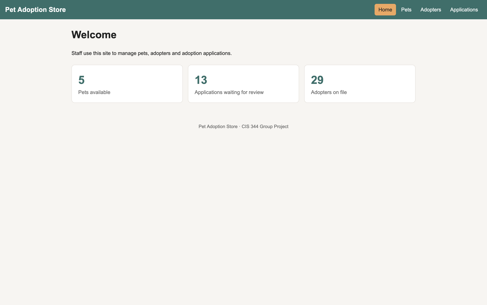

---

### Pets

#### View and filter pets

Click **Pets** in the menu. The list shows every pet's ID, name, species, breed, age, status, fee, vaccination status and, for adopted pets, who adopted it.

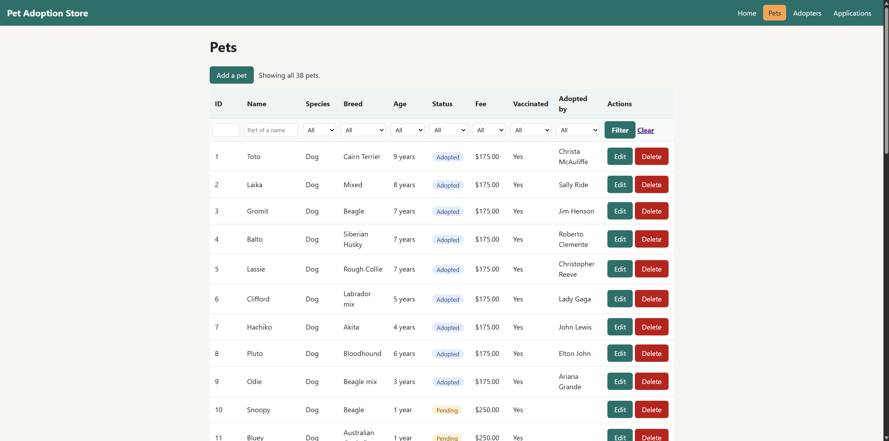

To narrow the list, use the filter boxes under the column titles. For example, choose **Dog** under Species and **Available** under Status, then click **Filter**. Filters can be combined. Click **Clear** to show every pet again.

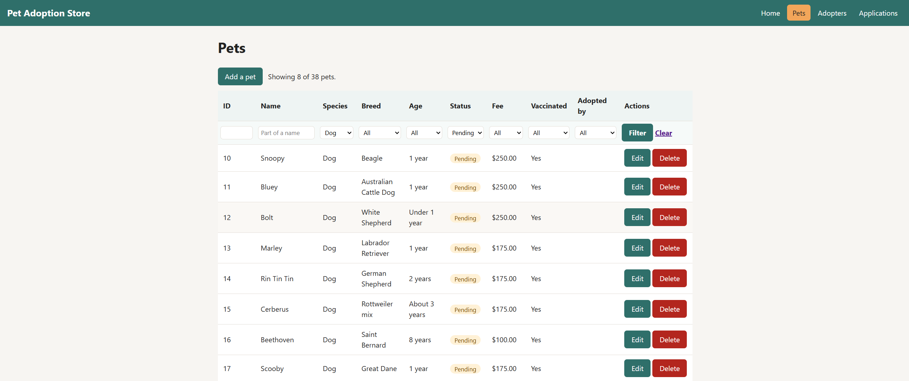

#### Add a pet

1. On the Pets page, click **Add a pet**.
2. Enter the **name**, choose the **species**, and optionally enter the **breed**.
3. Enter the **birth date** if it's known. If it isn't, enter an **estimated age** in years instead (Business rule #31). A pet can't have both.
4. **Adoption fee:** for dogs, cats, rabbits and birds, the fee fills in automatically from the price list and can't be changed (Business rules #29 and #30). For **Other** animals, type a fee from $10 to $75 (Business rule #32).
5. Mark whether the pet is **vaccinated**, then click **Add pet**.

New pets always start as **Available**.

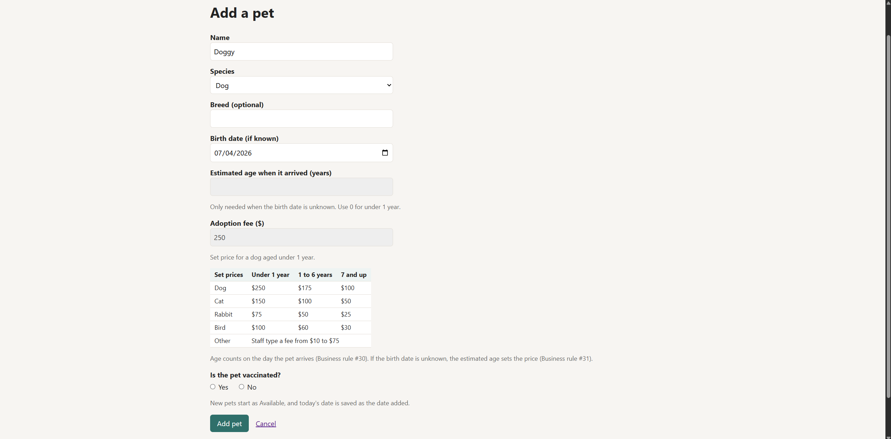

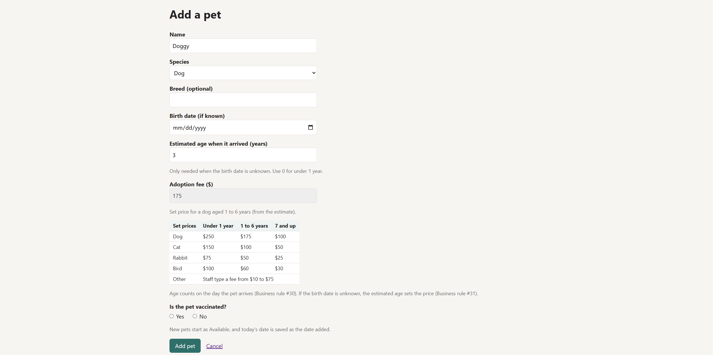

If something is missing or wrong, a red box lists what to fix, and what you typed stays in the form.

#### Edit a pet

1. On the Pets page, click **Edit** next to the pet.
2. Change the details and click **Save changes**, or click **Cancel** to go back without saving.

Staff can change a pet's status by hand in only two ways: **Adopted → Returned**, when a pet comes back, and **Returned → Available**, when it's ready for a new home (Business rules #18 and #19). The Pending and Adopted statuses are set only by the application process.

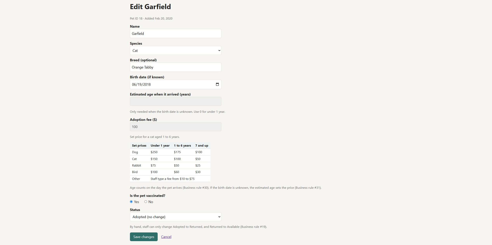

#### Delete a pet

1. On the Pets page, click **Delete** next to the pet.
2. Confirm in the pop-up.

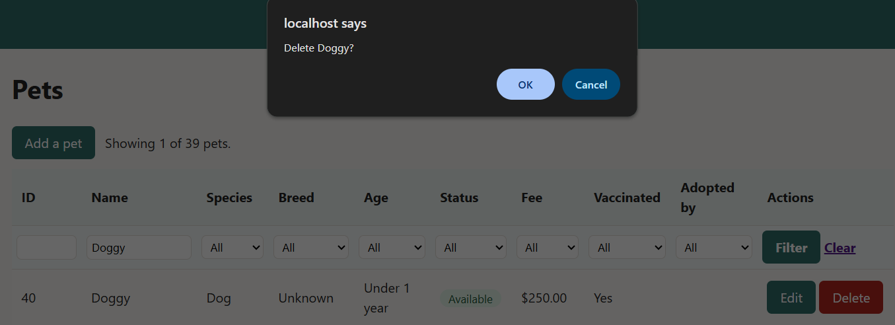

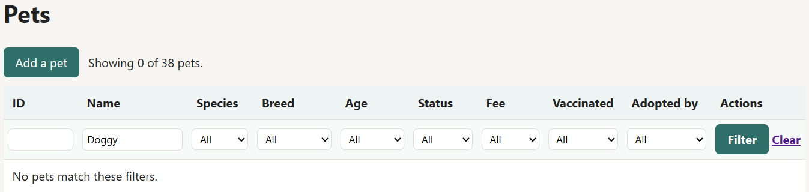

Only a pet with **no applications**, like one entered by mistake, can be deleted. Adopted pets are never removed (Business rules #17 and #28). If the pet has applications, the page shows a red message and nothing is deleted.

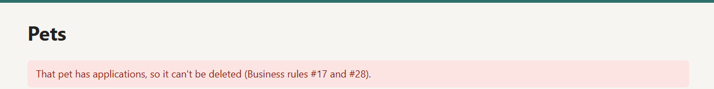

---

### Adopters

#### View, filter and sort adopters

Click **Adopters** in the menu. To protect personal data, the list shows only each adopter's ID, name and phone number. Use the boxes under the column titles to find an adopter by ID or name, or to sort by name or phone, then click **Filter**. Click **Clear** to reset.

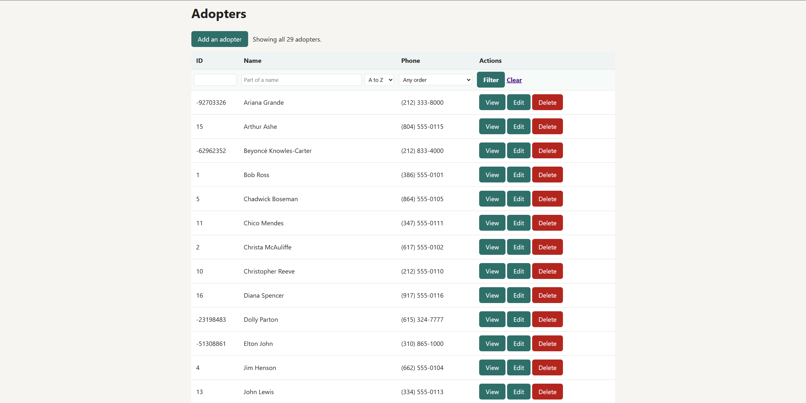

#### View an adopter's details

Click **View** next to an adopter. Their page shows their full details (email, address, date of birth, age and date joined) and a list of **every application** they've made, with its status.

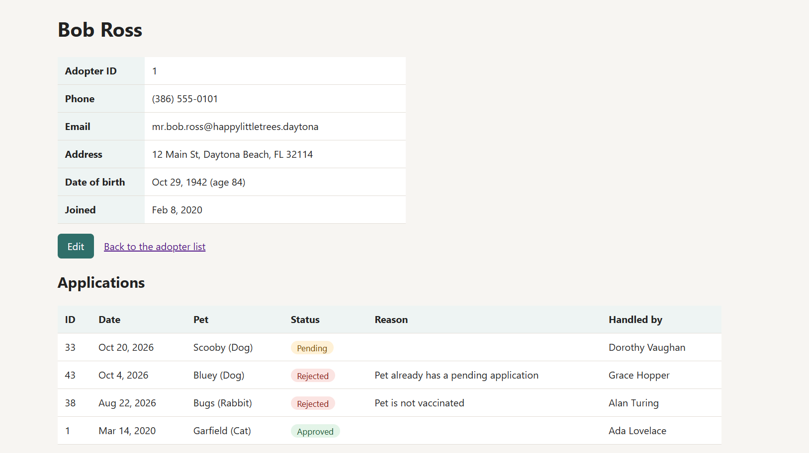

#### Add an adopter

1. On the Adopters page, click **Add an adopter**.
2. Fill in every field marked with a red star: first name, last name, phone, email, address and date of birth (Business rule #6).
3. Click **Add adopter**.

The adopter ID is assigned automatically, as the largest existing ID + 1, and the date joined is set to today (Business rule #12). Each email can be used by only one adopter (Business rule #7).

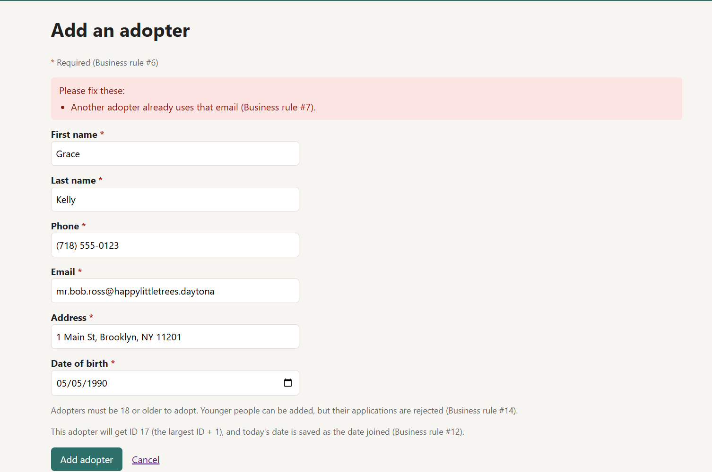

#### Edit an adopter

Click **Edit** next to the adopter, change their contact details, and click **Save changes**. The ID and date joined can't be changed.

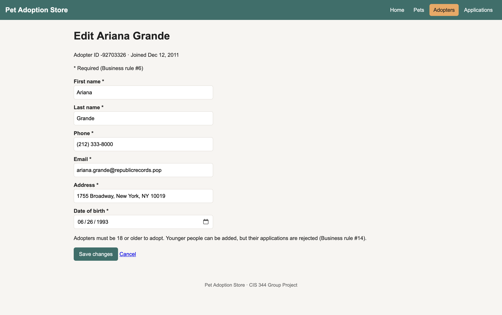

#### Delete an adopter

Click **Delete** next to the adopter and confirm. Only adopters with **no applications** can be deleted (Business rule #17). Otherwise, a red message explains why and nothing is deleted.

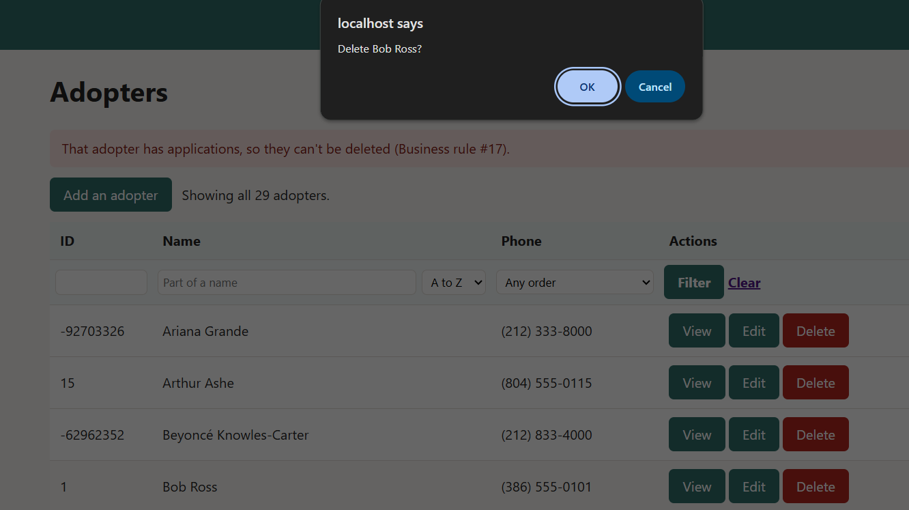

---

### Applications

Click **Applications** in the menu. Four tabs at the top switch between **Pending**, **Approved**, **Rejected** and **+ New Application**.

#### Enter a new application

Applications are entered by staff while they go over the application with the adopter.

1. Click the **+ New Application** tab.
2. Choose the **adopter**.
3. Choose the **pet**. Each pet shows its species and status, and pets that aren't vaccinated are marked.
4. Choose the employee who is **handling** the application. Only Adoption staff appear in this list (Business rule #22).
5. Click **Submit Application**.

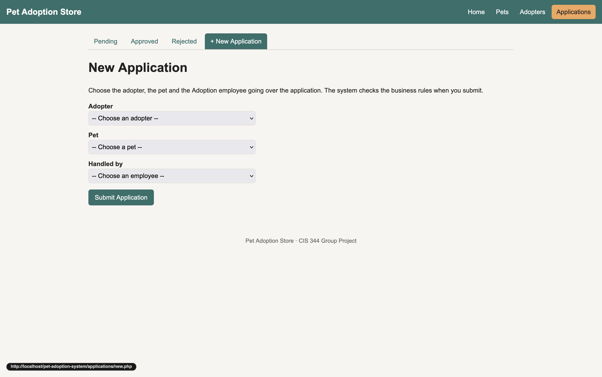

When you submit, the system checks the business rules:

| Check                                           | Business rule | If it fails                                           |
| ----------------------------------------------- | ------------- | ----------------------------------------------------- |
| The adopter is 18 or older                      | #14           | Rejected: "Adopter is under 18"                       |
| The pet isn't already adopted                   | #13           | Rejected: "Pet is already adopted"                    |
| The pet isn't back in care after being returned | #13, #18      | Rejected: "Pet was returned and is still in care"     |
| The pet is vaccinated                           | #13           | Rejected: "Pet is not vaccinated"                     |
| The pet has no other pending application        | #13           | Rejected: "Pet already has a pending application"     |
| The adopter has no other pending application    | #15           | Rejected: "Adopter already has a pending application" |

- **If every check passes,** the application is saved as **Pending**, the pet's status changes to **Pending**, and you are taken to the Pending tab with a green message.
- **If a check fails,** the application is saved as **Rejected** with the reason, and you are taken to the Rejected tab (Business rule #25).

#### Review pending applications

The **Pending** tab lists every application waiting for review, with the adopter's phone number so staff can arrange the home visit (Business rule #26).

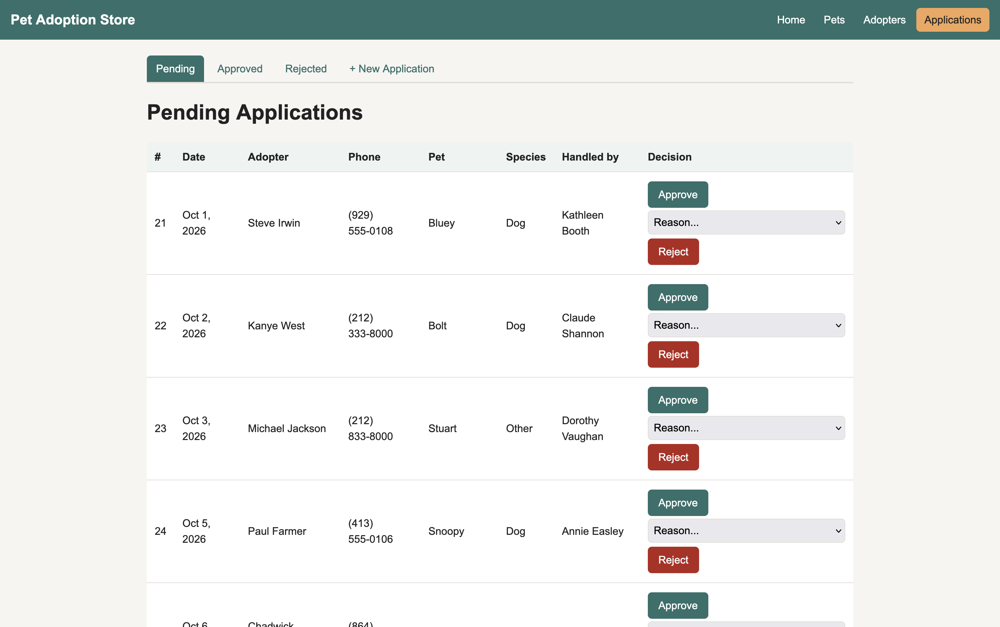

- **To approve:** click **Approve** and confirm. The application becomes **Approved** and the pet becomes **Adopted**.
- **To reject:** choose a reason from the list, either "Did not pass the home visit" (Business rule #26) or "Landlord does not allow pets" (Business rule #27), then click **Reject** and confirm. The application becomes **Rejected** and the pet becomes **Available** again.

Both actions run as one transaction, so the application and the pet always change together, or not at all (Business rule #16).

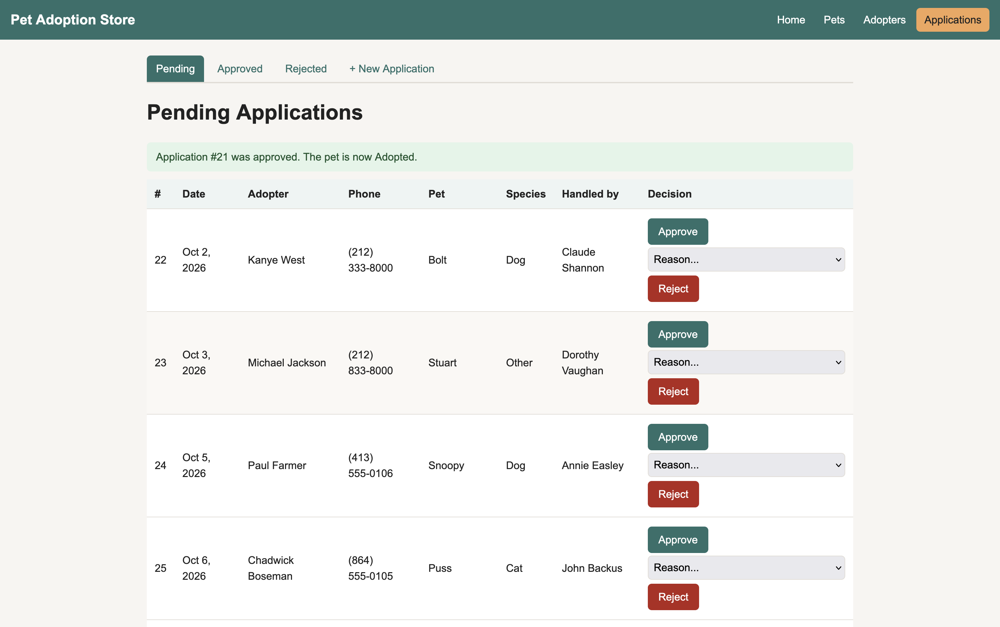

#### View approved applications

The **Approved** tab lists every completed adoption: the adopter, the pet, its fee, the pet's current status (Adopted, or Returned if it came back) and who handled it.

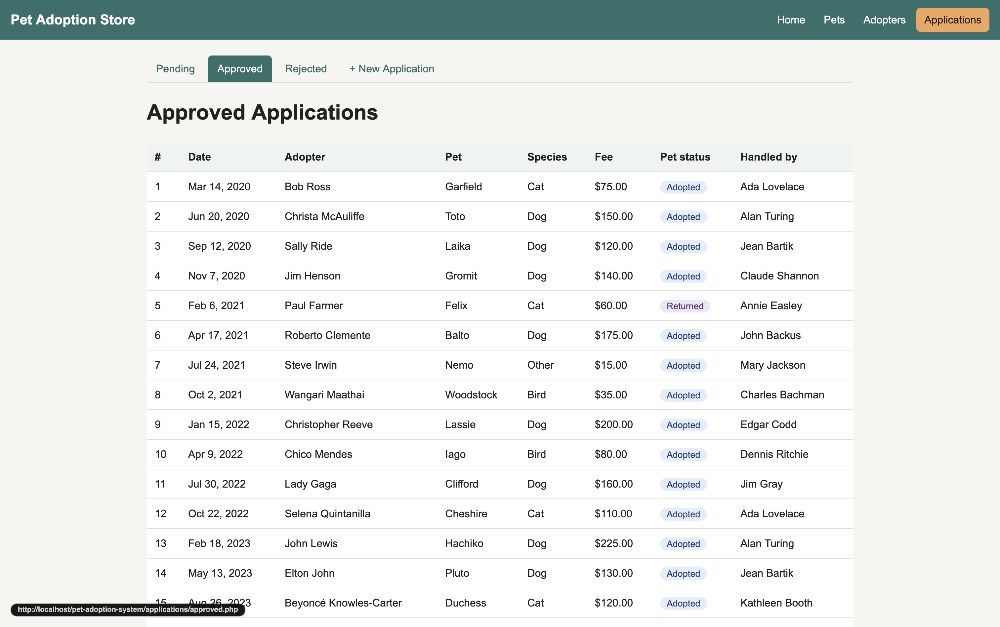

#### View rejected applications

The **Rejected** tab lists every rejected application with the reason and the business rule it broke.

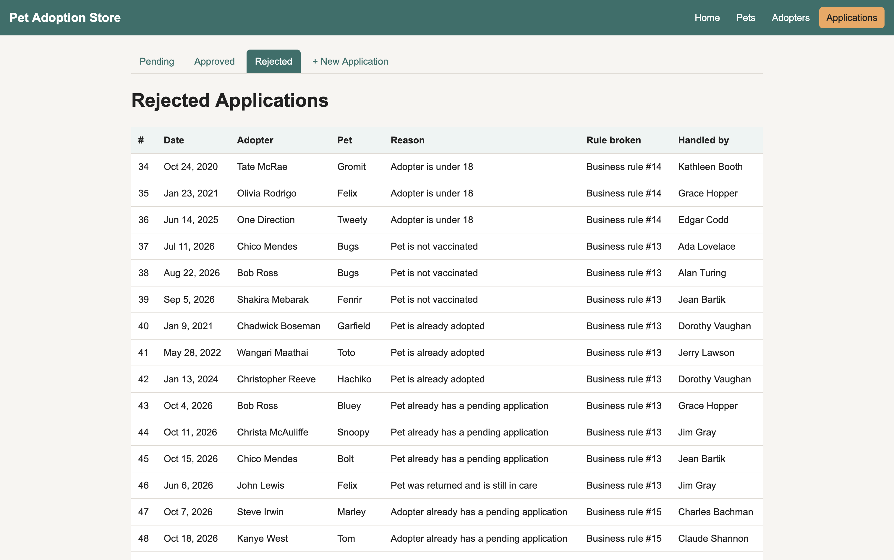

---

## Database

The database is built by [`database/schema.sql`](database/schema.sql).

| Table               | Holds                                                                             |
| ------------------- | --------------------------------------------------------------------------------- |
| `employees`         | Staff, with their badge number and department (Adoption or Sales)                 |
| `pets`              | Every pet, with its status, fee and vaccination status                            |
| `adopters`          | Customers who may adopt                                                           |
| `rejection_reasons` | The 8 reasons an application can be rejected, and the rule each one breaks        |
| `applications`      | Links one adopter, one pet and one employee, with a status and a rejection reason |

**Views:** `pending_applications`, `approved_applications` and `rejected_applications` join the applications table with adopters, pets, employees and rejection reasons, so the pages show names instead of ID numbers.

**Join queries:** [`database/queries.sql`](database/queries.sql) has the join queries used by the pages, including INNER JOIN, LEFT JOIN and GROUP BY queries, each with its expected result.

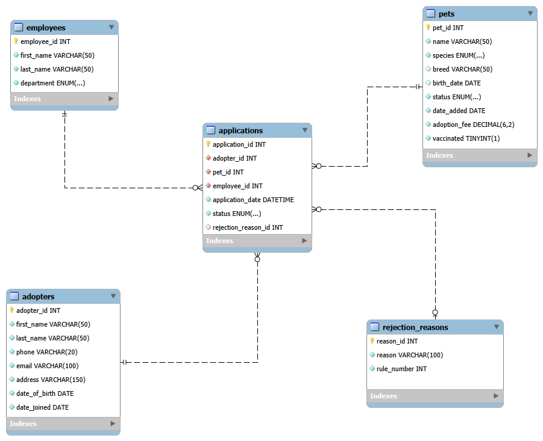

Screenshots of the database in Workbench:

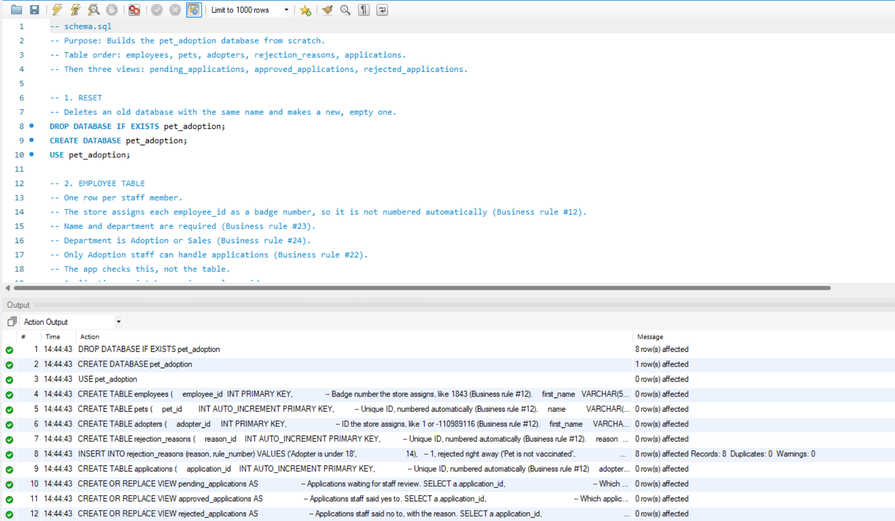
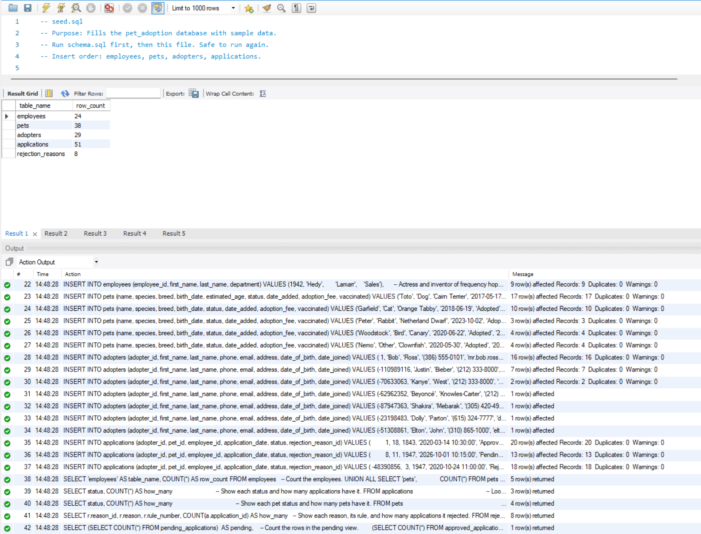
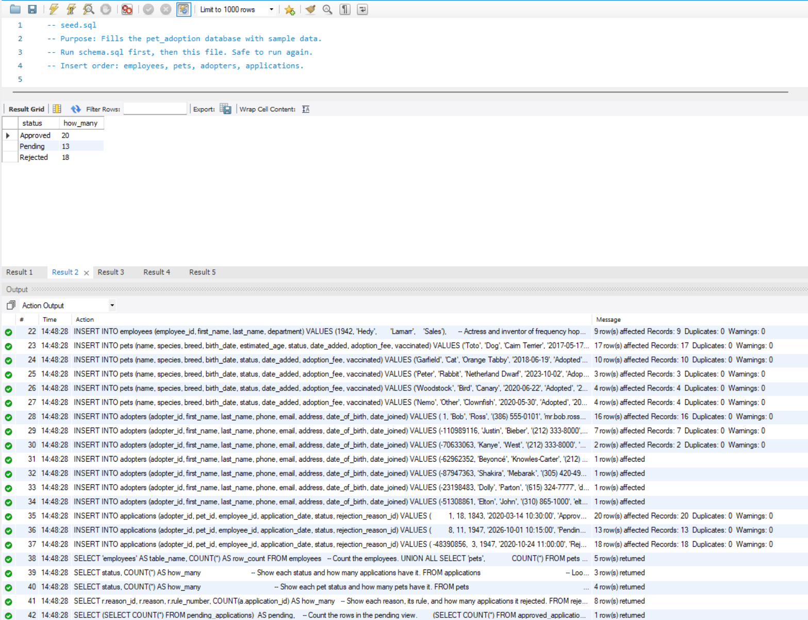
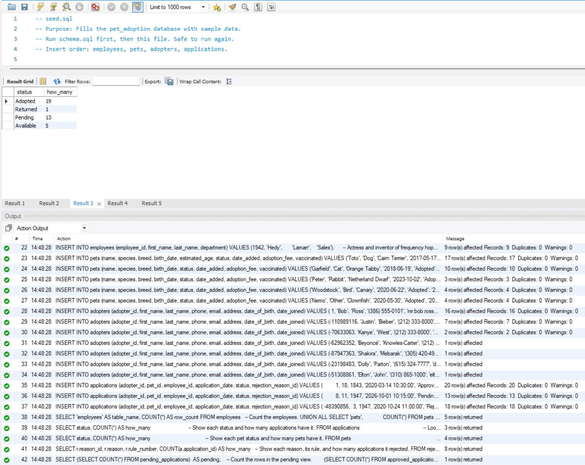
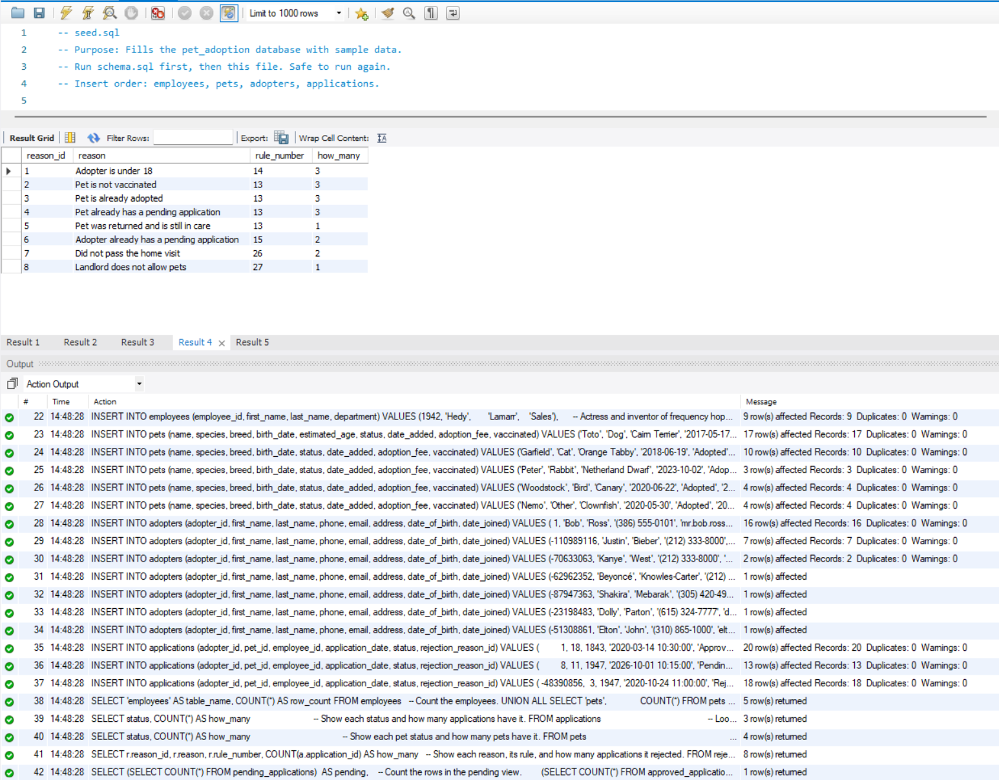
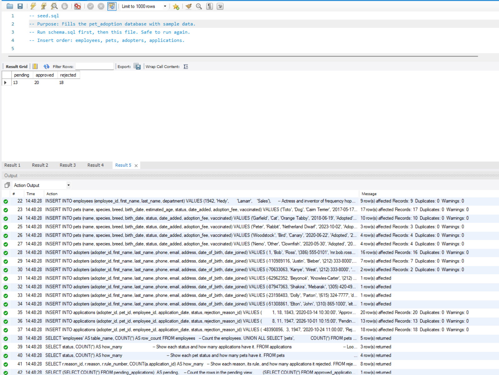

---

## Security

- **Prepared statements** for every query that uses input from a form or the address bar, so typed input can't change the SQL (SQL injection).
- **`htmlspecialchars()`** on everything shown on the page, so typed text can't run as code (XSS).
- **Server-side validation** in PHP on every form, plus browser checks for required fields.
- **Data changes only through form submissions (POST).** Deletes, approvals and rejections can't be triggered by opening a link.
- **Transactions** for approving, rejecting and creating applications, so the application and the pet never get out of sync.
- **Database constraints** (foreign keys, CHECK, UNIQUE and NOT NULL) enforce many business rules even if the PHP code is bypassed.

---

## Team

| Member | 
| ------ | 
| Benjamin |
| Fidel Perez |
| Jason | 

